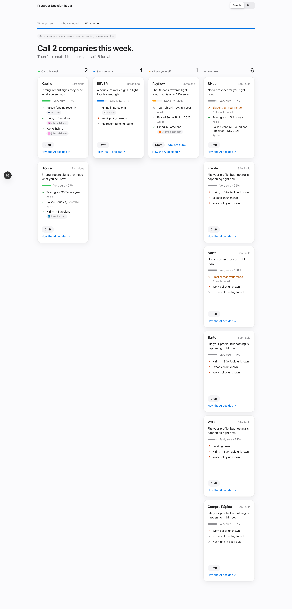
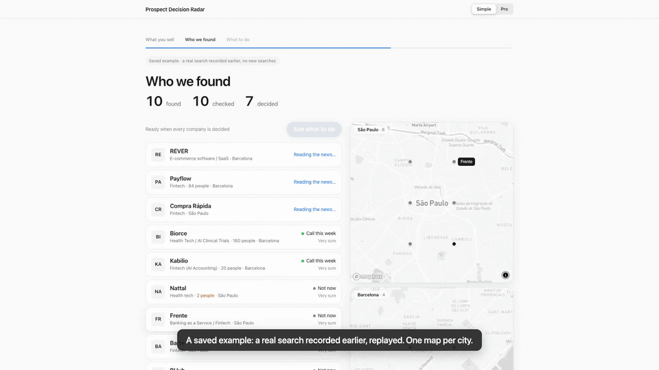

# Prospect Decision Radar

**Know who to sell to next.** A hackathon proof of concept by Alodai Labs: describe what you sell and to whom, and it
finds companies, researches each one with sources, and decides what to do with it (call this week, send an email,
check yourself, or not now), keeping an evidence trail for every decision. Nothing is ever sent.



Demo: [80-second video](docs/demo/prospect-decision-radar.mp4) · 

## Quickstart (60 seconds, no keys)

```bash
pnpm install
pnpm dev            # http://localhost:3000
```

In step 1, pick a preset and press **Use a saved example**: it replays a real search recorded earlier
(`fixtures/demo-run*.json`, derived fields only), labelled as such. No API key is needed for this. Click any company to
open its dossier, or go straight to one: `http://localhost:3000/?company=zazume&run=example-b2b-software-smb`.

`pnpm test` runs the unit tests; `pnpm build` checks the production build.

## Optional keys (live search)

Create `.env.local` with any of these variables (a template is in `.env.example` in the source repository). Any missing key means that provider is off or in fixture mode, and the UI says so.

| Variable | Provider | Used for |
| --- | --- | --- |
| `JEV_API_KEY_OPENROUTER` | Jev by TypeSafe, via OpenRouter | every decision (gate 1, gate 2, action) |
| `LINKUP_API_KEY` | Linkup | web discovery and per-company research with sources |
| `CALA_API_KEY` | Cala | company-data discovery |
| `APOLLO_API_KEY` | Apollo (optional) | organization enrichment only: headcount, growth, latest round |
| `NEXT_PUBLIC_MAPBOX_TOKEN` | Mapbox (public `pk.` token) | city maps and office geocoding |

Real calls are capped per session in `runs/call-ledger.json` (`CAP_JEV`, `CAP_LINKUP`, `CAP_CALA`, `CAP_APOLLO`,
`CAP_GEOCODE`). A live run never mixes in sample data: a source without a key stops with a note instead.

## How it works

1. **Discover**: Linkup structured search and Cala `knowledge/query` per target city, plus any companies you name.
2. **Gate 1 (Jev)**: does the company fit the profile on cheap data? Clear misfits are dropped.
3. **Enrich (Apollo, optional)**: company fields only, through an allowlist.
4. **Research (Linkup)**: one structured search per surviving company, every field with sources.
5. **Gate 2 (Jev)**: one yes / no / unknown question per buying signal, plus a size check, in one call per company.
6. **Action (Jev)**: call now, email, light touch, keep warm or skip. Below the review threshold it goes to "Check yourself".
7. **Draft**: a template filled with the evidence. Nothing is ever sent.

A profile is a seller's offer, buyer, cities, size range, sectors and a list of buying signals from the signal library
(`src/core/signals.ts`). The research fields, the questions and the drafts are derived from it
(`src/core/profile.ts`). Presets live in `profiles/*.json`: `workspace`, `b2b-software-smb`, `recruiting-services`,
`outdoor-advertising-media` and `custom`.

## Architecture

- `src/core/`: pure TypeScript, no framework (types, pipeline, signals, profile derivation, plain-language mapping,
  run-only overrides, fixture export, file IO). It ports as-is.
- `src/providers/`: one adapter per provider (Jev, Linkup, Cala, Apollo, Mapbox geocoding) with a session call budget.
- `src/app/`: Next.js. **Simple** is a guided 3-step journey; **Pro** shows the stream, the Jev probabilities, the
  threshold policy and a What-if that removes evidence and asks again.
- Every run is one JSON evidence trail in `runs/` (gitignored): inputs, events, answers with probabilities, sources,
  decision and draft. Porting notes: [docs/PORTING-TO-ALODAI.md](docs/PORTING-TO-ALODAI.md). Stage script: [DEMO.md](DEMO.md).

## Data rules

- Company-level data only. No people are searched, stored or shown, and no people endpoint of any provider is called.
- Apollo responses pass an allowlist of company fields; everything else (including investor names) is dropped.
- Map positions are city level unless a company's office address was geocoded.
- Keys are read from the environment only and never logged or stored.

## Status, honestly

- **Live** (run on a real stack, 2026-11-10/11): discovery (Linkup, Cala), research (Linkup), decisions (Jev via
  OpenRouter), enrichment (Apollo), maps and geocoding (Mapbox).
- **Fixture**: without keys the decider is a keyword heuristic, **not Jev**, and research reads `fixtures/research.json`
  (fictional companies). The UI labels both.
- **Saved example**: a recorded live search with derived fields only. It is always labelled as a saved example.
- Not production software: no auth, no multi-tenancy, file storage only.

## Credits

Jev by TypeSafe (via OpenRouter) · Linkup · Cala · Apollo (optional) · Mapbox.

Built by Alodai Labs ([alodai.com](https://alodai.com)). License: to be decided (see `LICENSE.TODO`).
